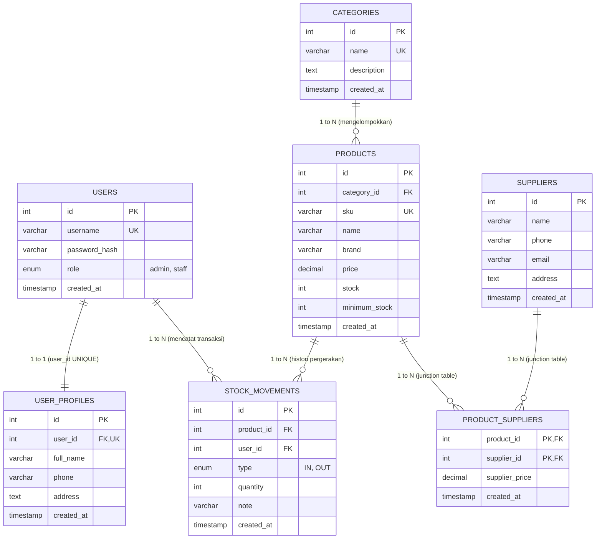

# Entity Relationship Diagram (ERD) & Relasi Database
## MELORA KOSMETIK – INVENTORY MANAGEMENT SYSTEM
**Mini Project 3 Pertemuan 4: Relational Database + Advanced PHP**

Dokumen ini menjelaskan rancangan arsitektur basis data relasional sistem inventory Melora Kosmetik sesuai seluruh materi dan ketentuan PPT Pertemuan 4.

---

### 1. Diagram Relasi Entitas (Mermaid ERD)

---

### 2. Penjelasan Jenis Relasi Sesuai Materi PPT

#### A. Relasi One-to-One (1:1)
* **Entitas:** `users` &harr; `user_profiles`
* **Implementasi:** Tabel `user_profiles` memiliki kolom `user_id INT NOT NULL UNIQUE` yang merujuk pada `users(id)`.
* **Karakteristik:** Setiap akun login tepat memiliki satu profil lengkap (nama lengkap, kontak telepon, alamat domisili). Kolom `UNIQUE` menjamin tidak ada duplikasi profil untuk satu akun login.
* **Integritas:** `ON UPDATE CASCADE ON DELETE CASCADE`.

#### B. Relasi One-to-Many (1:N)
* **1. `categories` &rarr; `products`**
  * Satu kategori kosmetik dapat mengelompokkan banyak produk.
  * Foreign key `category_id` diletakkan pada tabel anak (`products`).
  * Integritas: `ON UPDATE CASCADE ON DELETE RESTRICT`. Kategori yang masih digunakan oleh produk tidak boleh dihapus sembarangan untuk menjaga konsistensi katalog.
* **2. `products` &rarr; `stock_movements`**
  * Satu produk memiliki banyak riwayat mutasi pergerakan stok (masuk dan keluar).
  * Foreign key `product_id` diletakkan pada `stock_movements`.
  * Integritas: `ON UPDATE CASCADE ON DELETE RESTRICT`. Produk yang memiliki histori transaksi tidak boleh dihapus demi menjaga keutuhan audit akuntansi.
* **3. `users` &rarr; `stock_movements`**
  * Satu pengguna (Admin atau Staff) dapat mencatat banyak transaksi mutasi persediaan.
  * Foreign key `user_id` diletakkan pada `stock_movements`.
  * Integritas: `ON UPDATE CASCADE ON DELETE RESTRICT`. Pengguna yang tercatat dalam transaksi tidak boleh dihapus sembarangan.

#### C. Relasi Many-to-Many (M:N)
* **Entitas:** `products` &harr; `suppliers` melalui junction table `product_suppliers`
* **Implementasi:**
  * Satu produk kosmetik dapat dipasok oleh banyak supplier.
  * Satu supplier dapat menyediakan banyak jenis produk kosmetik.
  * Composite Primary Key: `PRIMARY KEY (product_id, supplier_id)`.
  * Menyimpan atribut tambahan: `supplier_price DECIMAL(12,2)` (harga beli/modal pengadaan dari distributor terkait).
* **Integritas:**
  * Foreign key `product_id` merujuk ke `products(id)` dengan `ON DELETE CASCADE`.
  * Foreign key `supplier_id` merujuk ke `suppliers(id)` dengan `ON DELETE RESTRICT`.

---

### 3. Business Rules Terkait Basis Data
1. **Uniqueness:** Kolom `sku` pada `products` dan `username` pada `users` wajib unik.
2. **Non-negativity:** Kolom `price`, `stock`, `minimum_stock` pada `products` dan `quantity` pada `stock_movements` harus divalidasi `non-negative` (dan `quantity > 0`).
3. **Stok Tidak Boleh Negatif:** Pada transaksi barang keluar, operasi diawali dengan `SELECT ... FOR UPDATE` dan divalidasi `quantity <= stock`. Jika melebihi stok, transaksi dibatalkan dengan `ROLLBACK`.
4. **Referential Integrity:** Penggunaan `ON DELETE RESTRICT` mencegah data induk yang memiliki relasi transaksional terhapus secara tidak sengaja.
